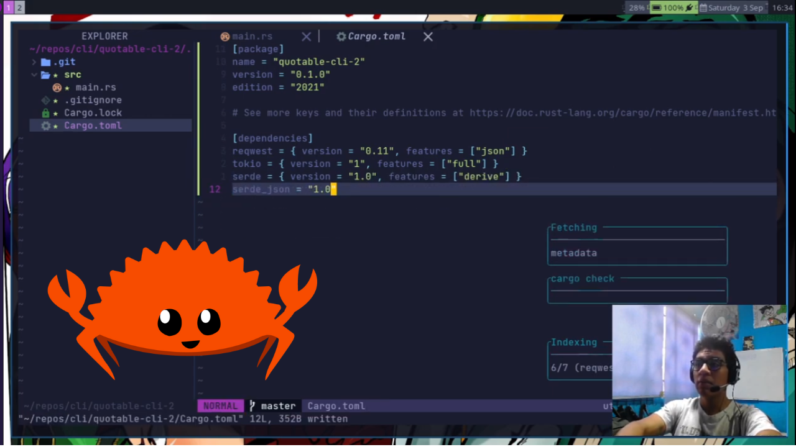

# Ruquotes

[](https://docs.rs/ruquotes)
[](https://codecov.io/gh/UltiRequiem/ruquotes)

API Wrapper and CLI tool for [Quotable](https://github.com/lukePeavey/quotable)
📣

[Live coding](https://youtu.be/so32pJcTFEo) 👇

[](https://youtu.be/so32pJcTFEo)

## Use your own API server

The public `api.quotable.io` host is no longer available, so point ruquotes at a Quotable server you run (the
project is open source). The base URL is read, in this order, from:

1. the `--api-url` flag (or the argument of `quote_from`),
2. the `QUOTABLE_API_URL` environment variable,
3. the public default, `https://api.quotable.io`.

Give the server address only, without `/random` (a path prefix such as `https://example.com/quotes-api` is fine).

## Installation

```sh
cargo install ruquotes
```

## Usage

```rust
use ruquotes::{quote, quote_from};

// the server from QUOTABLE_API_URL (or the default)
let quote = quote().await?;

// or a specific one
let quote = quote_from(Some("https://quotes.example.com")).await?;

println!("{} \n - {}", quote.content, quote.author);
```

## CLI

### Install

The same way as the library.

Or use a binary from
[releases](https://github.com/UltiRequiem/ruquotes/releases/latest).

### Usage

```sh
QUOTABLE_API_URL=https://quotes.example.com ruquotes
ruquotes --times 3 --api-url https://quotes.example.com
```

[Video Showcase](https://youtu.be/NsyMt8wLh6I) 📹

## Standing on the shoulders of giants

- 🗼 [tokio-rs](https://github.com/tokio-rs/tokio): A runtime for writing
  reliable asynchronous applications with Rust.

- 🤗 [colored](https://github.com/mackwic/colored): The easier way to have text
  on your term!

- 👏 [clap](https://github.com/clap-rs/clap): A full featured, fast Command Line
  Argument Parser for Rust

- ⚡ [reqwest](https://github.com/seanmonstar/reqwest): An easy and powerful Rust
  HTTP Client

## Support

Open an Issue, I will check it a soon as possible 👀

If you want to hurry me up a bit
[send me a tweet](https://twitter.com/UltiRequiem) 😆

Consider [supporting me on Patreon](https://patreon.com/UltiRequiem) if you
like my work 🙏

Don't forget to start the repo ⭐

## Authors

[Eliaz Bobadilla](https://ultirequiem.com) - Creator and Maintainer 💪

See also the full list of
[contributors](https://github.com/UltiRequiem/ruquotes/contributors) who
participated in this project ✨

## Versioning

We use [Semantic Versioning](http://semver.org). For the versions available, see
the [tags](https://github.com/UltiRequiem/ruquotes/tags) 🏷️

## Other Art

I also made this on [JavaScript](https://github.com/UltiRequiem/ranmess),
[Python](https://github.com/UltiRequiem/quoteran),
[a website](https://github.com/UltiRequiem/ulti-random-quotes), and
[Go](https://github.com/UltiRequiem/quotable).

## Licence

Licensed under the MIT License 📄
